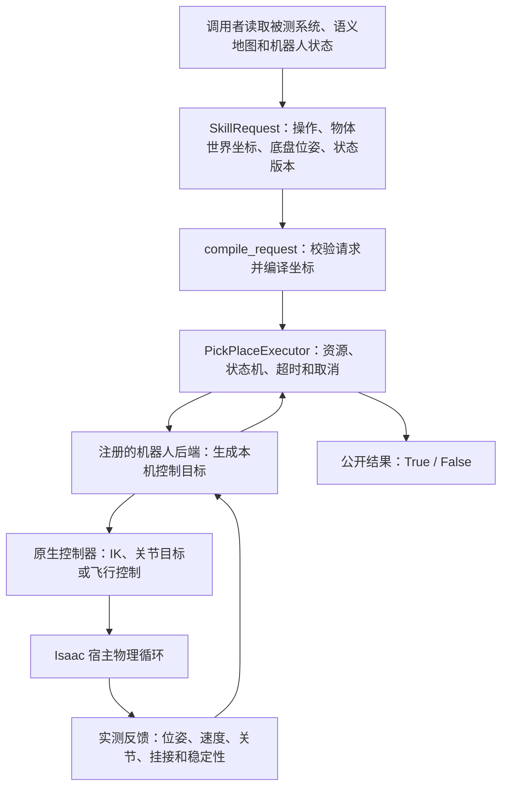

# 统一的局部 PickPlace

`PickPlaceExecutor.execute(request) -> bool` 执行一次 `pick` 或 `place`，结束后只返回 `True/False`。`True` 表示后端已经确认抓取并完成抬升/稳定持物，或确认释放并完成撤离/回收。接受命令、规划成功均不算执行成功。非法输入、不支持、不可达、错误、超时、取消都返回 `False`；原因写入日志。

调用者从被测系统和语义地图取得物体身份、世界坐标、底盘完整世界位姿与观测版本，再提交请求。调用者自行决定导航与何时放置。技能不会选择路线，也不要求 source/destination 引用或导航拓扑。

## 请求与调用

```python
from algorithm.skills import PICK_PLACE_SKILL_ID, SkillRequest
from task.executors import PickPlaceExecutor

# advance 必须调用宿主现有的 step；一个 step 可能包含多个物理 tick。
# 这里的 actions 由宿主管理，也可以包含其他机器人的命令。
skill = PickPlaceExecutor(
    advance=lambda: env.step(actions),
    simulation_time=lambda: host_simulation_time(),
    resources=shared_resource_manager,
    snapshot_validator=lambda command: semantic_map_accepts(command.world_state_seq),
)
skill.register_adapter(backend)  # 一个机器人实例对应一个后端

def operation(request_id, op, object_xyz, base_xyz, base_xyzw, sequence):
    return skill.execute(SkillRequest(
        request_id, PICK_PLACE_SKILL_ID, backend.robot_id,
        target_pose=tuple(object_xyz),
        parameters={
            "operation": op,
            "object_ref": "box_1",
            "base_position_world_m": tuple(base_xyz),
            "base_orientation_xyzw": tuple(base_xyzw),
            "world_state_seq": sequence,
            "simulation_time_s": host_simulation_time(),
            "timeout_s": 60.0,
        },
    ))

picked = operation("pick-1", "pick", object_xyz, base_xyz, base_xyzw, sequence)
if picked:
    caller_navigation()  # 自选导航方法；也可以完全不导航
    # 重新读取底盘位姿、仿真时间和观测版本。
    placed = operation("place-1", "place", destination_xyz,
                       latest_base_xyz, latest_base_xyzw, latest_sequence)
```

坐标单位为米，线上四元数顺序为 **xyzw**，后端内部为 wxyz。技能计算 `p_base = Rᵀ(p_world - t)`；可选 `orientation_xyzw` 表示物体最终世界姿态，也转换到采样底盘坐标系。可选 `grasp_offset_object_m` 是物体原点到抓取点的物体局部坐标偏移，原样传给适配器；安装外参和工具变换仍由适配器/控制器负责。后端必须明确支持该姿态，否则返回 `False`，不能忽略。当前四个内置后端均不支持任意物体姿态。

`target_pose` 在 pick 时是物体原点当前世界位置，在 place 时是同一物体原点最终世界位置。接触点、物体尺寸、安装外参、腕部偏移由后端处理。世界目标在操作开始时锁定，不随底盘移动漂移。默认拒绝超过 0.5 秒或来自未来的采样时间；宿主可以配置容许时差，并通过 `snapshot_validator` 验证语义地图版本与现场绑定。

同一 request id 与相同输入重复提交，返回已记录的布尔结果，不重复抓取或释放。改变输入或重试失败动作时必须使用新 id。一个 executor 属于一次宿主会话；宿主重置场景后重新创建 executor，并按现场状态协调原有资源租约。

## 后端接入

公共状态机为 `IDLE → PICKING → HOLDING → PLACING → IDLE`。错误反馈若确认仍持物且已停止操作控制，则回到 HOLDING；状态不明或停止未经确认则保留资源并进入内部 fault。反馈、阶段、错误均不成为公开操作返回值。

后端协议定义于 [contracts.py](contracts.py)：`resource_key` 解析物体别名为规范占用键，`validate` 做无物理副作用的校验，`start` 启动局部动作，`before_step/after_step` 衔接宿主循环，`feedback` 读取内部完成与持物证据，`request_stop` 请求安全停止。停止确认必须同时表示本次操作轨迹不再推进；持续持物可以继续通过物理挂接或后端持物钩子实现，并保持必要的关节目标。

| 后端 | 实际控制与挂接 | 宿主接入 |
| --- | --- | --- |
| `ArmPickPlaceAdapter` | UR5/Z1 柱坐标、IK、follow proxy；用 live arm root 处理安装外参，用实际 EE→物体偏移求解原点放置 | 传入现有 `IdealizedManipulationRuntime`；宿主原有 `run_post_apply` 持续驱动，首次局部抓取在回收位姿建立工具姿态，以较慢的 IK 积分避免振荡 |
| `DronePickPlaceAdapter` | 局部对齐、平滑下降、FixedJoint 挂接、抬升、释放、撤离；末段测量速度确认稳定 | 传入现有 `PhysxAerialTransportBridge`、实时位姿/时钟、目标写入和交还写入权回调；支持 PegasusIris/PegasusX4 的位置控制 |
| `PepperPickPlaceAdapter` | 双臂测量到达门控、随实测双手维持物体、释放与回收 | 在现有 Pepper composite controller 安装 `local_pick_place` delegate；每个物理步只执行一次双臂控制，底盘命令直接来自外部 |
| `G1PickPlaceAdapter` | Inspire 右手标定、影子 stage 规划、真实关节目标、实测掌部挂接与释放；pick 独立抬升后保持，place 才规划调用者选定的目标 | 传入共享 env/stage、`robot_name`、`robot_path` 与标定 `ObjectBinding`；通过宿主 `G1LiveRuntime` 物理钩子持续驱动。当前仅支持固定基座、直立轴向物体，不提供 G1 行走控制 |

UR5/Z1 后端可以注入 `reachable` 使用测量得到的能力范围；没有能力查询时，运动反馈和超时仍会拒绝无法完成的动作。Pepper 新物体的机器人/物体碰撞过滤必须由宿主在物理初始化前准备，后端通过 `collision_filter_validator` 确认。场景已有的碰撞配置、质量与重力属性保持由原生控制层管理。

G1 后端复用合并提交的资产哈希、物体尺寸与握持标定检查。绑定时检查固定 articulation，路径仅在影子 stage 计算；真正挂接须实测掌部、闭合手指到达，pick 须实测完成抬升及关节稳定，place 须实测物体原点到达、释放、回收并稳定。取消冻结实测关节且保持已有连接，不继续原自动搬运路线。固定站位的调用者可以选择不导航，再提供另一个可达世界放置点。

新机器人只需实现协议并注册，不修改公共状态机。隔离后的机器人身份可以使用 `env_0/robot_name`；机械臂/Pepper 后端通过 `robot_name`、`env_id` 映射到现有的每行原生控制器。对同一现场的所有调用者必须共享 `ResourceManager` 和相同规范机器人/物体键。

物体租约从 pick 开始保留到确认 place 清理完成；机器人运动租约仅在操作执行期间占用，便于外部导航接管。未知状态、停止失败或部分释放不会自动解除挂接。宿主必须尊重租约，不在操作期间另行向同一控制器写入命令。`cancel()` 或 `execute(..., cancelled=callback)` 取消正在执行的操作；取消仍遵守实际持物状态。

## 运行逻辑和数据流程

统一层管理取放契约和完成判断，四类后端分别适配六种机器人：UR5、Z1、Iris、X4、Pepper 和 G1。一次操作的完整数据链是：



调用者负责从被测系统和语义地图取得数据，创建请求并选择导航方式；skill 当前不会自行连接地图服务，也不会自行搜索路线。`world_state_seq` 只是把调用者看到的地图/现场版本带进请求，真正的版本一致性由宿主传入的 `snapshot_validator` 决定。

### 1. 请求怎样变成控制目标

一次请求的主要字段如下：

| 字段 | 含义 |
| --- | --- |
| `request_id` | 本次操作的唯一编号；重新尝试要换编号 |
| `robot_id` | 已注册的机器人实例 |
| `parameters.operation` | 这次只做 `pick` 或只做 `place` |
| `parameters.object_ref` | 操作的物体，由后端解析到真实场景对象 |
| `target_pose` | 物体原点当前或期望的世界 XYZ，单位米 |
| `parameters.base_position_world_m` | 采样时底盘的世界 XYZ，单位米 |
| `parameters.base_orientation_xyzw` | 同一采样时刻底盘的完整世界朝向，四元数顺序 xyzw |
| `parameters.world_state_seq` | 调用者使用的世界状态版本 |
| `parameters.simulation_time_s` | 上述现场状态的采样仿真时间 |
| `parameters.timeout_s` | 本次操作的仿真时间预算，默认 60 秒 |
| `parameters.orientation_xyzw` | 可选目标物体世界姿态，必须由后端明确支持 |
| `parameters.grasp_offset_object_m` | 可选物体原点到抓取点的局部 XYZ 偏移，单位米 |

`target_pose` 表示物体原点的位置。pick 时它是物体当前的世界坐标，place 时它是物体原点最终应到达的世界坐标。它不是桌面位置、抓取点或末端执行器位置。物体尺寸、抓取点、安装外参、腕部偏移和工具姿态由具体后端计算。

例如桌面高 0.7 米、箱体高 0.2 米且原点在箱体中心，箱体中心的放置高度通常应为 0.8 米。

请求编译时使用完整的底盘平移和旋转：

```text
p_base = Rᵀ (p_world - t)
```

也就是先用世界目标减去底盘世界位置，再用底盘旋转的逆变换到局部坐标。比如底盘在 `(10, 5, 0)`，车头朝世界正 Y 方向，物体在 `(10, 6, 1)`，机器人看到的目标就是“前方 1 米、上方 1 米”，局部坐标为 `(1, 0, 1)`。倾斜底盘也按完整旋转计算，不只使用 yaw。

编译后的 command 会同时保存采样时的底盘位姿和局部目标。后端需要恢复世界目标时使用这份采样位姿，因此底盘在导航期间移动不会让已经选定的放置目标跟着漂移。不同后端还会继续做自己的转换：机械臂通常需要相对于真实安装根的坐标，无人机需要挂接点坐标，Pepper 需要双手中点坐标，G1 需要手掌和关节目标。

坐标编译代码在 [provider.py](provider.py)。`PickPlaceProvider.plan()` 只返回 `SkillPlan`，其物理结果仍为 unknown；它不会推进仿真，也不返回操作成功的布尔值。实际执行入口 `PickPlaceExecutor.execute()` 直接调用 `compile_request`，不要求调用者先执行 `plan()`。

当前四个内置后端都不接受任意的 `orientation_xyzw`；请求虽然保留了目标姿态字段，但调用者显式传入一个后端不支持的姿态时必须得到 `False`，不能静默忽略。未传姿态时，后端使用自己的工具或挂接默认姿态。

### 2. `execute` 怎样推进一次操作

`PickPlaceExecutor.execute()` 是同步接口，通过宿主传入的 `advance` 回调推进现有 Isaac 物理循环，每次循环都读取后端反馈。执行必须在创建 executor 的宿主线程中进行，同一 executor 禁止重入；不能让多个调用线程分别推进同一个 Isaac 场景。`cancel()` 可以从其他线程设置取消信号。

一次执行按以下顺序进行：

1. 编译并检查请求；非法字段或错误维度直接返回 `False`。
2. 根据 `request_id` 去重。相同编号和相同输入返回缓存结果；相同编号换了输入会被拒绝，重试必须使用新编号。
3. 找到已注册的机器人后端，解析物体别名；复制公共状态机做预检，避免校验失败改变真实状态。pick 只能从空手待命开始，place 必须已经持有同一个物体。
4. 检查采样时间、可选的语义地图版本校验、物体实测位置和后端能力。默认不接受超过 0.5 秒或来自未来的采样。
5. 占用机器人运动租约；pick 还要占用物体租约，place 必须验证自己已经持有该物体租约。
6. 更新真实状态机并调用后端 `start`。后端返回“接受”只表示动作开始，不表示操作成功。
7. 循环执行 `feedback → 取消/超时检查 → before_step → 宿主 advance → after_step`，直到后端报告完成、失败或停止。
8. 对最终条件做统一判断：轨迹已完成、后端报告 ready 和 stopped、持物状态符合预期，place 还必须完成清理。满足才返回 `True`。
9. 失败、取消或超时时请求安全停止；最后整理内部状态、释放或保留租约、写日志并缓存最终布尔结果。

公共状态机的正常路径是：

```text
IDLE → PICKING → HOLDING → PLACING → IDLE
空手待命 → 正在抓取 → 已经拿稳 → 正在放置 → 空手待命
```

成功 pick 后停在 `HOLDING`，不会自动导航，也不会自动调用 place。调用者可以完全不移动，也可以用自己的底盘/飞行控制器导航，然后重新读取最新底盘位姿和状态版本再调用 place。`HOLDING` 期间宿主物理循环仍必须继续运行，因为不同后端需要每个物理 tick 保持手臂目标、跟随物体或保留挂接。

内部反馈会记录 `running/completed/failed/stopped`、`empty/holding/unknown`、`ready/stopped/clean` 和失败原因，但这些不会增加公开返回值。`stopped` 表示本次取放轨迹停止、控制权可以交接，不代表原生飞控或持物保持逻辑被关闭。

执行和停止收尾代码在 [pick_place.py](../../../task/executors/pick_place.py)。宿主动作应用顺序在 [multi_robot_direct_env.py](../../../source/EAI/EAI/hmrs_env/multi_robot_direct_env.py)：先应用控制器动作，再运行相应机械臂/G1 钩子；Pepper 在复合控制器里调用取放钩子。一个宿主 `env.step` 可能包含多个物理 tick，不能把两者当成同一个时间单位。

### 3. 各后端如何把通用请求变成动作

| 后端 | 底层目标 | 持物时怎样持续工作 |
| --- | --- | --- |
| UR5 / Z1 | 柱坐标和工具姿态经 IK 转成关节位置目标 | 宿主机械臂钩子保持关节，视觉代理跟随实测末端 |
| Iris / X4 | 世界位置目标经飞控转成推力和力矩 | 原飞控继续悬停或导航，FixedJoint 保持物体 |
| Pepper | 双手位置经 IK 转成双臂关节目标 | 复合控制器保持双臂，箱体随实测双手同步 |
| G1 | 规划的腰、右臂和手指关节目标 | 宿主 G1 钩子保持关节，物体随实测手掌同步 |

#### UR5 和 Z1：机械臂后端

两种机械臂共用 `ArmPickPlaceAdapter`，但使用各自的关节、夹爪和安装配置。后端先从真实机械臂安装根读取世界位姿，处理机械臂相对于底盘的平移和旋转；然后把物体原点、物体姿态和抓取偏移转换成末端目标。

pick 的实际阶段通常是：

```text
准备上方姿态 → 转向 → 径向靠近 → 垂直下降 → 抓取
→ 抬升 → 收回 → 保持持物
```

place 会使用抓取后保存的“末端到物体”实际偏移，反推末端应到的位置，使最终落到目标位置的是物体原点。柱坐标目标再交给现有 `IdealizedManipulationRuntime`，运行时通过共享平面 IK 输出关节位置目标；宿主的 `run_post_apply` 在每个物理 tick 继续驱动。阶段完成同时检查参考轨迹、实测末端和关节误差、工具姿态与稳定性，不能只按时间到点判断。Z1 还会确认夹爪实际到达开/关位置并稳定。

机械臂当前采用 follow proxy：开始 pick 时创建物体视觉副本，原物体暂时隔离碰撞和重力；持物期间副本跟着实测末端移动，原刚体可能仍停留在原位置；place 释放时再把原刚体写到副本的最终位置、恢复属性并删除副本。因此，语义地图在持物期间不能只读原物体 root 推断当前位置，应读取持物绑定或用“末端位姿 + 保存的物体偏移”计算。

代码入口：[机械臂后端](../../../task/executors/pick_place_backends/arm.py)、[机械臂运行时](../../../source/EAI/EAI/controllers/idealized_manipulation.py)、[IK 控制器](../../../source/EAI/EAI/controllers/ik_controller.py)。

#### Iris 和 PegasusX4：无人机后端

Iris 和 X4 共用 `DronePickPlaceAdapter`，差别主要是飞行器参数和旋翼配置。开始操作时锁定物体世界原点，计算物体抓取点与无人机挂接点的偏移。

pick 的过程是：

```text
上方对齐 → 临时支撑物体 → 平滑下降
→ 用实时 PhysX 位姿确认挂接点对准
→ 创建 FixedJoint → 删除临时支撑
→ 上升并确认稳定 → HOLDING
```

后端在 `before_step` 写入位置目标，在 `after_step` 用实际位置和速度判断阶段。原 Pegasus 飞控接收位置目标、实测位置/速度/姿态，计算推力、姿态和力矩，再生成旋翼控制量；它不是直接瞬移无人机根位姿。持物期间后端不再持续写抓取位置，FixedJoint 保留，飞控可以悬停或执行调用者的新导航目标。

place 会使用当前无人机位置、当前物体位置和目标物体原点做补偿，下降末段还会按实测误差修正；随后删除挂接、恢复碰撞、上升撤离，并确认物体没有明显漂移。错误发生在已经挂接之后时，连接会保留，避免布尔失败导致物体凭空掉落。无人机“对齐”是直接位置目标，没有路径搜索和避障，所以接近路线仍由外部调用者负责。

代码入口：[无人机后端](../../../task/executors/pick_place_backends/drone.py)、[实时位姿与物理挂接](../../../task/executors/aerial_pick_place.py)、[Pegasus 飞控](../../../source/EAI_assets/EAI_assets/controller/traditional/pegasus_multirotor/controller.py)。

#### Pepper：双臂和外部底盘分工

Pepper 注册 `local_pick_place` 后，旧的固定路线和自动运输分支被绕开。外部给出的底盘命令直接进入 Pepper 的全向底盘控制器，取放后端只负责双臂和物体；复合控制器每个物理步调用一次 `local.physics_step`。

pick 时，后端从真实移动的 `base_link/base/torso` 读取底盘位姿，根据箱体位置和姿态算出左右手目标。双臂用位置 IK 接近，必须确认两只手实测到位并稳定；然后记录箱体相对双手中点的位姿，抬升双臂，并确认箱体实际到达高位。

持物期间，每个物理 tick 都根据实测双手中点、底盘姿态和保存的偏移，直接更新箱体 root pose 并清零速度。这是逻辑挂接，不依赖接触力。调用者可以独立移动底盘，但不能抢写双臂持物目标。place 使用最新底盘位姿计算两手目标，确认箱体到达目标后停止同步箱体，让 PhysX 接管，再让双臂回 home 并稳定；释放后还会检查物体是否漂移。

Pepper 的双臂 IK 复用了历史类 `G1BoxGraspRuntime`，类名中的 G1 不表示当前 G1 新后端也使用同一套控制。当前底盘把外部 `[vx, vy, wz]` 积分为平移/旋转关节目标，移动模型没有通过真实车轮转速实现。

代码入口：[Pepper 后端](../../../task/executors/pick_place_backends/pepper.py)、[复合控制器](../../../source/EAI_assets/EAI_assets/controller/traditional/pepper_box_transport/controller.py)、[全向底盘控制器](../../../source/EAI_assets/EAI_assets/controller/traditional/pepper_holonomic/pepper_holonomic.py)。

#### G1：固定基座、右臂和 Inspire 右手

G1 后端使用资产/绑定/标定检查，并把真实机器人、关节和物体同步到一个关闭物理的 shadow stage。这个副本只负责规划数学路径，不是第二个物理仿真。

pick 只规划“准备 → 接近 → 抓取 → 抬升 → 保持”；place 请求到来后，才根据本次世界目标和实际掌部到物体的偏移规划转移、下降、释放、撤离和回收。规划器使用笛卡尔路点和 IK，做关节限幅、速度平滑以及调用者传入的障碍检查；它不会自动从语义地图获取所有障碍。

真正执行时，宿主 `G1LiveRuntime` 钩子把腰部、右臂和右手指目标写入 live articulation，并等待实测关节跟上。挂接前检查掌部抓取点误差、掌朝向和手指实际位置；挂接后每个物理 tick 根据实测掌部更新物体 root 并清零速度。place 需要同时确认物体原点误差、只释放一次、手臂回收和速度稳定。当前 G1 是固定基座版本，不包含抓取后的行走控制。

取消时，新后端冻结停止瞬间的实测关节目标并保留已有挂接，不再继续旧完整搬运路径。基座发生移动会被视为错误，因此当前不能在 pick 后移动 G1 根位姿来模拟行走运输。

代码入口：[G1 后端](../../../task/executors/pick_place_backends/g1.py)、[现场执行和影子场景连接](../../../task/executors/g1_live.py)、[G1 规划器](../../../task/executors/g1_manipulation/planner.py)。

### 4. 导航交接、失败和资源

典型调用顺序是：

```text
读取现场 → pick → 等待 True
→ 调用者自行导航或不导航
→ 重新读取底盘位姿/时间/状态版本
→ place → 等待 True
```

成功 pick 后，机器人运动租约可以释放给外部导航，但物体租约必须保留到 place 清理完成。ResourceManager 是协作约定，不是可以拦截所有底层写入的硬防护；调用者需要共享同一个 manager、使用同一规范机器人键，并只接管自己的底盘或飞行通道。Pepper 和 G1 持物期间不能让外部导航逻辑覆盖双臂/持物手臂目标。

`False` 表示“这次取放没有完整满足成功条件”，不等于“机器人一定空手”。例如可能是没有抓到，也可能是已经抓住但抬升失败，或者已经释放但撤离失败。取消、超时、时间倒退、无法确认停止或部分释放时，后端会依据实际持物状态保留连接和资源；未知状态不会被强行当成空手清理。

| 失败后的实测情况 | 内部处理 |
| --- | --- |
| 确认仍持物，而且本次操作已停止 | 回到 `HOLDING`，保留连接和物体租约 |
| 确认空手、已停止且清理完成 | 回到 `IDLE`，释放相应租约 |
| 持物未知、清理不完整或停止未确认 | 进入内部 `fault`，保留物体资源；停止未确认时隔离运动租约 |

重复请求返回的是那个历史操作的缓存结果，不能用它查询当前是否持物。宿主重置场景后也需要重新创建 executor，并核对旧资源租约，不能继续沿用旧状态和缓存。

### 5. 当前实现边界

地图和被测系统数据由调用者提供，skill 不连接导航拓扑或自动选择路线。四类内置适配器当前不接受任意目标姿态；它们会明确拒绝不支持的姿态。机械臂 follow proxy、Pepper/G1 逻辑跟随和无人机 FixedJoint 是仿真中的持物模型，`True` 表示对应模型已完成实测门控的取放流程，不代表真实接触力或负载极限。

## 验证

```bash
PYTHONPATH=.:source/EAI:source/EAI_assets:source/EAI_hmrs \
PYTEST_DISABLE_PLUGIN_AUTOLOAD=1 python -m pytest -q \
  algorithm/skills/tests task/tests \
  source/EAI/test/test_idealized_manipulation_runtime.py \
  source/EAI/test/test_environment_view.py

# 在可用的 Isaac Python 环境运行；每个进程只创建一个宿主仿真。
python tools/validation/unified_pick_place_smoke.py --backend drone --trials 10 --report /tmp/unified-iris-10.json
python tools/validation/unified_pick_place_smoke.py --backend drone --drone pegasus --trials 10 --report /tmp/unified-x4-10.json
python tools/validation/unified_pick_place_smoke.py --backend pepper --trials 10 --report /tmp/unified-pepper-10.json
python tools/validation/unified_pick_place_smoke.py --backend arm --arm ur5 --trials 10 --report /tmp/unified-ur5-10.json
python tools/validation/unified_pick_place_smoke.py --backend arm --arm z1 --trials 10 --report /tmp/unified-z1-10.json
python tools/validation/unified_pick_place_smoke.py --backend g1 --trials 10 --report /tmp/unified-g1-10.json
```

轻量测试覆盖坐标转换、安装外参、布尔结果、重复请求、非法输入、错误反馈、取消、超时、持物保留、外部导航、单次释放和回收。Isaac 报告应记录控制器、适配器、资产哈希、实际抬升、持续持物、释放、撤离和资源清空证据。
