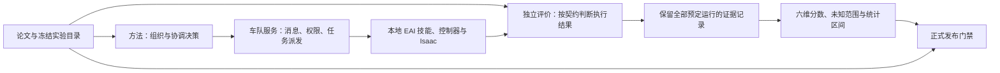

# 论文驱动的工程推进记录

原实施规范来源：Overleaf 工程 6ab4c7c4e984abb8da9c8113，当前冻结提交
`1f329494e755523692f5f96c8e0889c6cec15a82`，来源目录为 `/home/pupil/CVPR2026_Template`；Overleaf old remote 于 2026-10-21 15:45 更新，`75ceff6`、`bb82b7b` 与此前的 `af12f6d` 仅作历史基线。
`artifacts/p0-p5/paper/` 保留的是旧 `07dcd40` 的历史快照，不是当前论文。本线程没有修改论文工作树。

版本边界：本报告此前的历史验收仍保留，但只表示旧提交下的工程证据，不能直接解释为
当前论文的正式分数。当前代码已把 scorebook/registration 绑定到 `1f32949`；D2 有限样本主区间、
D3 注册分区、D5 低于 family floor 的披露和 D1–D4 unknown 的 incomplete 语义已经按该提交
验证；D1 保留其注册覆盖门下排除未知实例的特定规则。论文工作树没有修改。

本轮结论：论文对应的协议、统计分析、目录注册和缺陷检查机制已经落地；D1/D4 的
首次计划、双可行性支持和时间线评价入口已补齐；实验入口
已切换到当前工程的本地 EAI，并完成真实机器人运动诊断。正式科研实验尚未完成：
还缺完整车队和候选方法的共同起点验证、认证实例、独立校准以及实际基线和缺陷对照数据。

## 新论文驱动的 GPU 阶段顺序（G0–G6）

`1f329494...` 新增的 `app:shared-session` 改变了执行阶段的依赖：shared-session 是 GPU-parallel Isaac Lab 的候选优化路径，只有在三路 qualification 和 isolated audit 完成后才能承载正式 paired evidence。执行顺序固定为：

1. **G0 身份冻结**：记录论文 SHA、Isaac/Isaac Lab、driver、GPU UUID、actual physics/controller device、source provenance、execution mode、batch/slot map 和 qualification record。
2. **G1 单场景 GPU 收据**：真实 GPU physics/controller、checkpoint readback、物理 predicate、lease/memory、clean Kit shutdown 和 telemetry cleanup。
3. **G2 三路 qualification**：同一 block 比较 uninterrupted、independent-process restore、shared-session restore，覆盖 slot permutation、batch range、邻居负载/回滚、slot reuse、hold 和 concurrent session；检查 evaluator ledger/离散观测/技能结果/里程碑精确性与连续状态容差。
4. **G3 isolated audit**：对 shared-session block 做 hash 抽样 open-loop isolated replay，计算 discordance 上界并计入 `eta_exec` widening。
5. **G4 paired pilot**：只在 G2/G3 通过后运行 reference/fact（必要时 sham/intervention）并保留完整 identity chain。
6. **G5 P4 认证**：GPU 上完成 canonical package、独立 oracle checker、physical witness、独立 calibration 和 baseline identity。
7. **G6 P5 归因**：在认证 GPU case 上运行 nominal/fault/sham/intervention 和 held-out recovery。

当前 G0 已完成，G1 只有 GPU task body 诊断而 clean shutdown 未通过，G2/G3 尚无真实收据；因此所有 formal gates 继续为 `false`。CPU、合成 vectorized backend 和只写 `requested_device=cuda` 的结果只能作为协议/诊断证据。任何 Isaac/Kit 运行结束后必须执行 `pkill -9 -f omni.telemetry.transmitter`，并将清理结果写入收据。

分支回溯优化已从用户指定会话接入，详见 `TOOL_RECOVERY_INTEGRATION.zh-CN.md`。
检查点持久化与原生时钟诊断的当前阶段见 `DURABLE_RECOVERY_PROGRESS.zh-CN.md`：
软件可以保存并校验注册状态；原生时钟及 sham 续跑仍失败，不能升级为正式恢复资格。

| 阶段 | 已经实现并验收的部分 | 尚未完成的部分 |
| --- | --- | --- |
| P0 论文规范 | 固定 `1f32949`，拒绝 stale registration；shared-session GPU branch 与 isolated-execution audit 已登记为新前置条件 | fixed-system、external-contention/protective-stop、GPU qualification/audit 仍缺生产执行接线；完整目录/校准/基线仍缺 |
| P1 工程契约 | 对齐共同起点、义务子类、失败/未知值和固定权重 | 真实运行须按这些契约提供证据 |
| P2 本地部署 | 本地 EAI/资产、GPU 环境可用性、真实 L 路线诊断；当前 GPU 运行主体完成但 clean shutdown 未观察到 | 完整车队/候选方法状态、GPU 物理收据、shared-vs-isolated qualification 与技能/目录资格认证 |
| P3 统计引擎 | 六维分析、固定权重 unknown range、D2 有限样本 retention set、D3 obligation disposition/ledger、D5/D6 固定目录范围、发布校验 | 正式数据输入后的科学结论；D2 差值与 Holm 仍需更多数值审计 |
| P4 目录与校准 | 注册、覆盖、校准和缺失项检查机制 | 已认证实例、独立校准批次、合格基线 |
| P5 缺陷归因 | 缺陷开关、sham 和归因验收规则 | 真实六维对照、因素交互和留出集恢复 |

## P0：规范冻结与验收映射

| 阶段 | 论文要求与依据 | 工程责任 | 验收依据 |
| --- | --- | --- | --- |
| P0 | 六维分数与实验身份；补充材料 statistics | 主代理：版本、目录、参数追踪 | 论文 SHA、测试与条款映射 |
| P1 | communication、dynamic-metrics、adaptation、statistics | 主代理：共同检查点、义务子类、未知值、校准身份 | 错误输入拒绝、等权和缺失边界测试 |
| P2 | 三层系统边界；真实执行证据 | Sol：本地 source、启动器、单场景执行 | 导入来源、真实仿真日志、明确物理限制 |
| P3 | statistics 与 D2 retention projection | 主代理：分层整簇重采样、投影区间、固定目录界限 | 人工可核对样例、常量/零分母/配对测试 |
| P4 | coverage、algorithm identity、canonical oracle、D6 calibration | 主代理：目录与基线注册、整数 tick 合同 producer/checker、独立校准 | 重复身份拒绝、witness/proof 独立复核、证书/覆盖缺失门禁 |
| P5 | supp_result_panels 的 planted defect attribution | 主代理：预埋缺陷与对照验证 | 名义等价、目标维度下降、sham、恢复检查 |

论文中仍为 xxx 的数值不能伪造为正式配置；软件支持与正式实验认证分别报告。
未认证的测试数据只用于验证工程语义，不构成论文结果。

P0 反思：仅查看最新提交说明会漏掉此前的实质方法修订。本次检查完整版本差异：
07dcd40 相对 3a59b7b 只有行号变化，但此前 7fb7762 改动 D2 区间和 D4 起点。
另外发现旧工程 D4 使用任意工作权重且排除失败事件，与论文冲突；P1 必须修复。

## P1：协议结构，首批验收

共同检查点须早于通知、携带公共历史和独立校准身份；P3 的 J/S 属性归属于每条
义务；D5 记录同检查点三次重复的有/无参考对照；D6 从独立校准批次成功运行计算中位数。
D4 修正为工作项等权，已验证的方法失败保留在主要评价集合。未知操作仍不能冒充
已验证方法失败；刻意不可行的 safe-stop 单独报告。

首批验收：协议、动态、发布、六维公式与结构测试 48 项通过。
反思：记录身份、未知值与抽样规则必须一起落实，不能只改公式或增加字段。
后续统计阶段将验证未知值两端与区间，不把缺失改写为失败。

## P2：独立工程部署与真实运动诊断

实验入口固定工作目录为 `/home/pupil/HeteroCoord`，EAI、EAI_assets、EAI_hmrs
均从当前工程的 `source/` 导入；USD、控制器资源和实验输出也使用当前工程路径。
若进程已经加载外部 EAI，则明确拒绝混用。保留现有共享 Conda/Isaac 运行环境，
没有改动其全局 editable 安装；这里的独立是项目源码、资源和实验输出隔离，
并不宣称已经复制一套独立的 Conda 或 Isaac 安装。

真实验收使用 `EAI-Factory-Z1-v0`。先验证四台机器人场景可加载并推进八步，
随后在 Carter 上运行低速前进与停车诊断：40 步稳定、100 步驱动、60 步停车，
保存驱动和停车阶段的 160 个实测状态。前进距离为 0.239497 米，目标距离为
0.20 米，终点误差为 0.039497 米，停车末速度为 0.000857 米/秒，满足预先
指定的诊断阈值（目标半径 0.15 米、停车速度不超过 0.08 米/秒）。

证据位于 `artifacts/project_runtime/command_loop.json`。该检查直接发速度指令，
没有通过瞬移制造位移；它证明指令、控制器和外部位置评价已经连通。它不经过正式
拓扑导航，也未完成技能认证或公共检查点回放，记录中的论文计分资格为 false。
进程退出码为 0，但 Kit 退出后未观察到 Python 上下文清理完成，不能宣称关闭链
已单独验证。

P2 反思：最初的运动检查在指令阶段失败，原因是执行器没有指定 Carter 的
控制命令；场景成功启动不能证明执行链有效。补齐明确连接后才观察到真实运动。
早期失败 JSON 被同名运行覆盖，相关历史不能当作完整保留的失败收据；后续诊断
需要不同运行路径，防止成功记录覆盖故障过程。诊断入口已增加启动前拒绝覆盖检查。
此前检查认为缺少匹配的 scene.json。进一步核查发现工程有 office 场景描述，但它的
场景标识和已生成地图的来源摘要不匹配，不能直接组合。Factory 的原生场景加载器
则已经能提供真实场景；后续集成采用该加载器并冻结实际加载层和明确路线，未把
office 的不匹配产物改写成已验证来源。

### P2 后续：统一导航与完整资产路径检查

`tools/validation/project_local_node_route.py` 固定一个 Factory Carter L 形路线，
使用正式统一导航接口提交符号终点，由宿主统一推进物理步；外部评价独立检查
起点、拐点、终点的有序实测到达和停车。运行 `node_route_02` 成功：分别在
第 40、191、420 步经过三个节点，最终误差 0.118988 米（预设半径 0.12 米），
末速 0.0005665 米/秒，保存 414 个状态采样。该实例的控制链集成通过，不构成
全目录技能认证；没有碰撞回避或论文六维得分声明。

首次完整 USD 层清单暴露了 import doctor 未覆盖的问题：Orsus 生成的运行时资产
仍写入用户主目录缓存。本轮将运行时资产和 LiDAR 缓存都固定在项目 tmp 内，增加
符号链接越界拒绝测试。`node_route_01` 保留外部缓存证据，修复后的 `node_route_02`
加载层外部路径为空、87 个源文件/资产身份在运行前后不变。

反思：本地导入并不等于全部资产本地化；必须审计实际加载层。任务成功也不能只看
导航器返回值，因此新增“跳过拐点但到终点仍失败”“仍在运动不能算完成”和
“物理时钟重复无效”测试。失败收据在退出原生会话前持久化，避免 Kit 退出吞掉记录。

### P2 后续：共同起点的首次真实恢复检查

`checkpoint_01` 使用现有物理回放模块保存并恢复七个 articulation 的状态，包含
命令、环境缓冲区、执行器、USD 状态、睡眠和随机状态组件。读回通过 1e-5 的预设
诊断容差，最大位置差约 3.17e-7 米；但仿真时间从 0.81 秒继续到 1.21 秒而没有
回退。恢复后执行同样的 20 步命令，最大关节速度差约 0.06257，超过预设容差。
因此结果明确为失败，不能用于论文严格配对。这里的数值不是论文归一化回放误差。
还缺技能、任务、算法、通信、锁和事件的完整因果状态；没有通过放宽容差取得通过。

反思：物理位置读回接近，不代表下一步动力学和事件时序一致。后续应检验新进程
重建同一起点及公共历史的方案；已有检查点只能按已测覆盖范围声明能力。

### P2 后续：新进程重建的实测结果

`reconstruct_record_01` 与 `reconstruct_verify_01` 分别在独立进程（PID 533588、
539469）执行同一固定初始化和命令日程。40 步共同起点之前以及其后 20 步相同
继续运行，共 60 步的 42 个记录通道逐值完全一致：包含七个 articulation 的
位姿、速度、关节状态与目标、物理时钟、命令以及 Python/NumPy/Torch 随机状态。
验证器没有向新进程注入原始位姿或动作来制造匹配，而是重新执行固定日程。

这个结果支持继续开发新进程重建的共同起点后端，尚未证明活跃技能、方法内部状态、
通信、锁、事件或接触求解器隐藏状态全部一致，也未进行处理分支释放。因此严格
因果回放资格仍为 false。首个状态恢复失败和重建成功是两条不同路径，均保留原始证据。

根据实测教训，因果快照登记新增显式 clock 参与者，深拷贝保存状态，防止恢复回调
污染原始快照；任何部分恢复失败会隔离该运行登记，禁止把它当成干净运行再次使用。
恢复写入完成后还会逐项读回，与保存状态比较；恢复函数没有报错不能替代状态一致。
默认严格比较，物理适配器可以使用预先登记的容差，时钟不会随位置容差一起放宽。
反例测试验证了缺时钟拒绝、可变状态不串扰、空操作恢复被识别和失败后的隔离行为。

### P2 后续：活跃任务、公共历史与真正的分支运行

本轮把共同起点从固定速度日程推进到真实导航任务。固定公共协调器通过实际共享信道
发送导航授权，消息在第 42 个协调时刻送达后才派发技能并获取路径占用锁。此后记录
技能路由进度、执行器状态、停止确认计数、真实资源租约、消息提交/送达/消费历史、
信道队列与随机状态。新增接口只测量状态，不提供未经验证的恢复功能；可复现租约
身份需要显式启用，默认随机身份及原来的对象真实性检查均保留。

`active_record_01` 在第 120 个物理步登记共同起点：机器人仍以 0.180035 米/秒运行，
导航未完成，路径锁仍占用，另有一条真实在途消息和 26 条公共事件。随后继续 40 步。
`active_verify_01` 在另一进程重建：全部 160 步的 42 个数值通道以及逐步的软件状态、
命令历史严格相等；原始/验证进程 PID 分别为 568544 和 572645。

只有绑定成功的完整 sham 收据，新的独立进程才允许核对前 120 步后释放分支。
`active_hold_01` 和 `active_continue_01` 分别在 PID 574949、576254 运行，起点物理状态
与公共历史逐值相同。保持分支在 40 步后末速为 0.000267129 米/秒；继续分支前进约
0.139607 米，末端物理状态与原始运行一致。两种分支都保留独立 40 步日志，停止与
继续的差异来自边界之后的实际控制，没有注入原始位姿或动作来强行对齐。
四次运行的 379 项源码/资产指纹一致、运行前后未变；源码和配置副本也随收据保存。

验收仍限于已声明的物理观测和软件状态。没有证明 PhysX 隐藏求解状态、完整车队运行时、
候选算法内部状态或所有外生事件已被覆盖；保持/继续也不是论文的功能失效干预。
所以严格因果回放、技能认证、论文计分资格仍为 false。这里的两分支验证解决的是
工程启动基础，不能填写 D4/D5 或缺陷归因结果表。

阶段反思：只验证静止位姿或公共时钟会漏掉活跃技能、未送达消息和锁计数。
现在把这些状态放在同一个非空边界核对，并保留后续分支日志。下一步应按完整任务
契约接入候选方法和独立评价，再按正式目录进行校准；不能把单场景重复当成跨域覆盖。

## P3：统计计算与可复核入口

新增以预定运行记录为输入的分析入口。D1–D4 对基实例整簇抽样并保留重复、条件与
配对关系；共享生成流作为同一组，跨分层共享流目前明确拒绝，要求另行注册联合抽样。
D2 先估计同时保持率区间，再投影到逐层封顶的分数。零参考重采样保留为 0/无穷两端，
常量样本用 Hoeffding 替代虚假的零宽区间。D5–D6 使用固定目录的独立运行权重。
另有配对差值、区间反演、六维 Holm、连续通过的容量边界、竞争风险与 RMST、精度规划。

分析入口保留三次预定重复；部分重复未知只扩大其自身权重对应的范围。报告包含
论文版本、输入摘要、随机种子和区间方法，不能直接把“统计就绪=true”当作发布依据。
发布门禁现要求六维统计报告与分数、工程版本一致。

验收：统计/分析/发布相关 41 项检查通过（包括既有回归）。
反思：原来的统计布尔开关不足以支持可复核发布，已替换为报告绑定；D3 的关系分层
和 D5 的目录权重必须由正式注册输入提供，不能用任务展示标签或成功次数推算。

独立复审修正：Sol 发现 D5 多单元不能当成独立样本，现按案例×重复先合并再估计
Hoeffding 区间；分拆相关单元不再缩窄区间。D5/D6 必须逐项匹配冻结运行目录，
漏项、替换检查点、修改权重均拒绝。D2 的两系统条件现从一次联合抽样计算。
未知端点采用下端点下尾 alpha/2、上端点上尾 alpha/2 的总误差分配。
D3 增加独立关系支持计算，按领域×难度×条件分层；改展示标签不能改变结果。
某次抽样丢失全部关系支持时不会删除该次抽样，并显式标记区间无效，阻止正式发布。

通信链复查另外修复：延迟消息的在途保存、过滤接收时未选中消息的保留、消息类型
保真、同物理tick多次调用不重复增加容量。通信快照现保存随机状态、队列与在途消息；
这仅是通信状态恢复，不冒充完整物理检查点。

## P4：正式目录、基线与校准

本轮新增 `benchmark/canonical_oracle_v3.py`。它是当前工程中第一个真正生产
合同级可部署性 witness 或完整穷举 infeasibility proof 的有界后端：输入明确冻结
机器人能力/角色、obligation、整数 tick、coalition、precedence、资源容量、mutex
和 deadline；输出由独立 checker 重新核验。搜索预算耗尽、未支持或 checker 不一致
均为 `feasibility_unverified`。它不优化、不调用外部 solver，也不把 EAI 的二维 A*
预筛查改名为 canonical oracle。

这个后端目前只覆盖显式细粒度合同。`task_catalog.json` 中的 30 个锚点仍只有
高层字段，缺少认证所需的完整 robot pool、资源和逐义务时序，所以不能直接喂入该
后端并自动变成 released cases。对应测试覆盖 witness、role/capability、joint
coalition、整数 tick precedence、resource/mutex、infeasibility proof、tamper 和
budget exhaustion。

已有 30 个作者定义的场景锚点，三个领域各 10 个。实际审计显示全部仍为
planned / not_yet_certified；21 个 common 标记也不是已认证的跨域案例。
工程已提供重复身份检查、覆盖检查、参数注册、固定运行目录、基线清单和独立校准
中位数区间/敏感性计算。容量数值、校准批次、共同检查点、目标适配目录等没有真实
证据的项目保留为空并由 formal_readiness.json 列出，不能自动生成正式结论。
基线清单共 15 项，其中 11 项已有实现注册、4 项不可用；实现注册不等于完成当前
物理基准的资格验证。正式准备检查当前列出 13 项缺失，包括共同起点目录、目标
适配参考目录、容量、队列规则、独立校准和认证证据。

2026-10-21 的门禁补强进一步拒绝仅凭字符串声明完成 P4：标记为 certified 的正式
case 必须同时绑定 catalog、machine contract、oracle proof、artifact manifest、共同起点
和 physical evidence 的小写 SHA-256，并且 oracle 必须是 terminal deployable 或
team-state-infeasible；baseline 除 adapter/checkpoint/observation contract 外，还必须绑定
fixed system、task family、starting team、budget、observation interface 和 artifact manifest。
这些字段是来源链的必要条件，仍不是认证本身。当前 30 个 anchor 和 11 个已登记实现
没有因此升级，正式 readiness 仍保留原有 13 个 blocker。

反思：补齐配置字段不等于完成实验注册；现有“30 个场景锚点”也不等于每个实验
单元都已有 30 个独立认证实例。摘要格式校验仍不能单独证明 artifact 内容真实，下一轮
需要让正式 case/baseline verifier 消费可重算 payload 和 typed receipts。本阶段的软件
检查已落地，正式实验目录仍待认证。

## P5：预埋缺陷与归因验证

已实现可接入提交系统的模块：忽略消息时效、丧失功能后不重新分配、无效 sham。
模块检查验证：正常无延迟时消费一致；过期时仅通信缺陷继续消费；无功能损失时
分配行为一致；损失后禁止重分配保持锁定，重新开始运行时清零状态。
归因检查分别保留名义成功等价、六维预测模式、外部失败记录、因素交互与留出集恢复。
等价要求整个区间落入预定界限，不能以“不显著”代替等价。

反思：单元测试能验证缺陷开关的行为，却不能证明 D2/D4 的物理实验选择性下降。
当前缺陷结果明确为 synthetic_module_behavior_only；正式结论依赖 P4 目录和真实
六维对照、留出集恢复数据，尚未完成。

## 重现与证据

首轮完整 benchmark 验收：222 passed in 2.52s；代码空白检查通过。
D3 与 D5 的独立 CLI 重算输出与已保存报告逐字一致。ZCode 另执行了早一轮
指定的 51 项协议/统计测试，退出码0。Sol进行了统计独立审查并提供可复现反例，
其关键问题已修复；这些检查没有替代正式物理试验。

首轮扩展检查不全绿：任务、技能和方法桥接测试中，5 个文件因旧导航模块/导出缺失而
无法收集；显式排除这 5 个文件后，其余结果为 211 passed、4 failed。4 个失败
均引用旧的 ground_navigation、goal_position 或 velocity 技能 schema。当前 HEAD
已经将正式导航统一为 node_route，上述旧模块在 HEAD 中也不存在；本次没有恢复
旧导航作为正式入口。下一阶段须迁移或明确退役旧测试，并验收统一导航链。
因此“222 项通过”仅指 benchmark 测试集，不等于全仓测试通过。
Sol 核对删除来源为此前的 fcf593a9 迁移，当前任务执行器依赖的新导航符号均存在。
另有 simulator 相关有界回归 28 passed、1 skipped；历史 demo 相关的两个测试因
缺 demo 包未能收集，也不计入通过数。诊断输出拒绝覆盖检查实际返回退出码 2，
已保存的成功轨迹 SHA-256 保持不变。

继续阶段已完成统一导航测试迁移，保留路由方向、能力限制、XY/XYZ差异、停止确认、
时序和身份一致性检查；退役的坐标直达技能改为明确拒绝测试，没有恢复旧接口或
通过跳过测试取得通过。该阶段合并验收经 ZCode 复核为 **557 passed in 3.35s**，覆盖 benchmark、
task/tests、algorithm/skills/tests、HeteroCoord方法桥接、共同协调契约以及两组
拓扑资产测试。这个结果替代上面的旧导航失败状态，仍不是全仓所有测试通过。
新增活跃状态测量及分支门禁后，相同合并范围为 **573 passed in 3.43s**。

回放组件扩展检查为 61 passed、7 failed；7个失败均依赖已删除的 demo.fire_rescue
验收入口。该历史测试迁移缺口尚未处理，不影响本轮真实重建收据的独立核对，
也不作为通过证据。原地checkpoint恢复失败仍是实际限制。

从项目根目录运行：

```bash
/home/pupil/miniconda3/envs/env_isaaclab/bin/python -m tools.project_runtime doctor
PYTEST_DISABLE_PLUGIN_AUTOLOAD=1 /home/pupil/miniconda3/envs/env_isaaclab/bin/python -m tools.project_runtime exec -- python -m pytest -q benchmark
/home/pupil/miniconda3/envs/env_isaaclab/bin/python -m tools.project_runtime exec -- python -m benchmark.verify_p0_p5
/home/pupil/miniconda3/envs/env_isaaclab/bin/python -m tools.project_runtime exec -- python -m benchmark.analysis_v3 artifacts/p0-p5/acceptance/D2_input.json --output artifacts/p0-p5/acceptance/D2_recomputed.json
```

`artifacts/p0-p5/acceptance/` 保存六维人工构造输入、输出、源文件摘要、目录/基线审计、
正式准备门禁和工件哈希。所有 synthetic 分数只验证计算，不可填入论文结果表。

新物理检查建议通过外层监督入口启动，使用新的输出目录：

```bash
/home/pupil/miniconda3/envs/env_isaaclab/bin/python -m tools.project_runtime exec -- python -m tools.validation.run_project_probe navigation --output artifacts/project_runtime/navigation_next
/home/pupil/miniconda3/envs/env_isaaclab/bin/python -m tools.project_runtime exec -- python -m tools.validation.run_project_probe reconstruction --output artifacts/project_runtime/reconstruction_next
```

监督入口保存 native.log 和 supervisor.json，同时检查进程退出和子进程收据。
Kit可能在失败路径仍返回退出码0，只有收据明确通过才验收成功。这里的recorded只
代表重建基准日志生成完成；须再用另一进程带 --reference 指向其 run/journal，
获得 verified 后才有重建对比结论。

## 开发者应理解的整体结构



方法决定做什么，车队服务执行接口规则，物理层提供实测状态，独立评价层决定成功
和失败。统计层只分析评价记录，不从方法日志推测成功。发布门禁还需要正式目录、
物理证据和独立校准，单独的高分或单元测试通过不能代替它们。

当前下一条关键路径：在已测共同起点基础上接入完整任务契约、候选方法和独立评价，
补足完整车队/方法/事件的状态覆盖；随后由固定独立协调器获得容量与资源校准，生成并认证正式
实例目录；最后执行基线、预埋缺陷、sham 和留出集恢复。P4/P5 的真实数据验收尚未
完成，不能将本次软件层推进标记为全部科研实验完成。

后续任务的具体验收顺序：

1. 最小任务：一个明确任务契约、许可拓扑、机器人角色、固定技能与独立后置条件；
   输出完整实测轨迹、方法命令和成功/失败原因，不能只凭控制器命令被接受。
2. 公共起点：独立协调器生成共同检查点与公共历史，恢复后读回物理/控制器/技能/
   通信/锁/事件/随机状态，并进行 sham 回放；误差超注册容差则不进入配对主实验。
3. 独立校准：在候选测试外重放记录消息流、验证低容量闭环，并冻结四档容量、
   队列规则和资源参考中位数区间。当前论文未给数值，不从候选成绩反推。
4. 正式目录：按领域、关系、难度和条件实例化、独立认证并检查覆盖；D5每个纳入
   的家族至少30个已认证案例，保留每个案例的单元和三次完整重复。
5. 基线与归因：登记实现版本和信息权利后运行共同目录；预埋缺陷有独立的多重比较
   家族，分别验收名义等价、因素交互和留出集模块恢复。

### 分支回溯工具接入反思（2026-10-20）

用户指定会话中的工具提交 `c51e86d756210e9f76623db25fbf090d282b6234` 已按文件/API
层接入当前工程的 `tools/benchmark_branch` 和 `tools/physics_replay`。这次接入只负责
执行容量、资源生命周期、登记式重试和回放缓存，不能把工具测试当作论文物理证据。
当前工具回归为 **315 passed、14 skipped**；跳过项是可选环境和未随工程提供的旧
`demo.fire_rescue` 入口。

主工程新增仅限同进程诊断的 `benchmark/recovery_bridge_v3.py`，代码拒绝 `measured`
正式运行，只接受 `measured_diagnostic`。它在 `BranchPlan` 冻结之前从完整
`ReplayStateRegistryV3` 捕获十类状态（world、clock、controller、skill、task、algorithm、
transport、locks、events、rng），并将完整版本化快照、参与者摘要和随机流摘要登记到
job。登记式重试恢复后必须重新读回全部状态、逐项匹配并在第一条 step 前发出唯一收据；
任何读回失败都会隔离 registry，不生成成功凭据。接口测试覆盖实际执行器与离线验证的
完整闭环、原失败记录保留、错误读回隔离、冻结数据防篡改和拒绝 fresh initialization。
测试使用可控状态参与者，尚未给真实 Isaac 的十类参与者实现完整恢复。

独立审查指出：工具只能检查后端提交的收据字段一致性，不能证明后端确实恢复了物理
状态；本桥的完整快照也只保存在当前进程内。因此正式恢复仍缺受信 native driver、
持久化快照及其版本/内容校验加载器。没有宣称支持崩溃后的跨进程恢复。参与者恢复
顺序现固定为十类必需项的定义顺序，再按名称排列扩展项，与插件注册顺序无关。

最终有界验收：原主工程合并范围 **586 passed**（原 573 加 13 项恢复桥测试）；
工具范围 **315 passed、14 skipped**。这两组不是全仓所有测试。缓存基准在当前工程
复测为 25,180,160 → 786,880 字节（留存解压数组减少 96.875%），状态摘要一致；
读取耗时约 0.0484 → 0.1448 秒。没有 RSS、瞬时内存峰值、GPU 吞吐或物理保真提升结论。
原始数据在 `artifacts/tool-cache-integration.json`。

阶段反思：先确认源提交和所有权，再接入工具，最后验证主系统的真实读回接口，避免
把字段一致性当成物理恢复。新增桥接代码改变了当前源码指纹；之前 native 诊断的
封存源码与结果仍作为历史证据保存，不能当作本次代码版本的新物理验收。

当前 active reconstruction 仍是独立 fresh-process 诊断，不能使用旧 logical branch 的
`attempt+1`。新进程需要上游分配新的 base/pair 身份；新的 controller 子流在本接口中
不支持，不能据旧稿的特殊例外自动放行。当前三个正式资格标志仍为 false。
最新论文 `75ceff6` 中基础设施重跑、方法失败保留和 fresh-process 身份规则未改变；
原 controller 子流特殊例外已删除。完整新指标差异审查仍是下一阶段工作。

### 当前论文对齐阶段反思（2026-10-20）

这一阶段先修复了版本绑定，再修统计语义。版本绑定已经有独立回归测试：旧的
`07dcd40` 会被 registration 拒绝，当前工程产物明确记录 `75ceff6`。最新论文已经明确
D3 的 relation cells 不包含 display-only primary label；工程将
`domain_difficulty_condition` 作为正式 relation partition，primary-stratified 仅保留为
显式诊断模式。D2 也拆开了主分数的有限样本 paired retention
percentile 与 operating-boundary 的 simultaneous retention projection，避免把边界工具当成
主 headline 区间。D1–D4 的未知记录不再通过两端填补发布 residual range；D5/D6 仍保留固定
目录的可识别范围。以上是协议层和统计层进展，不能升级物理资格或正式论文结果。

### 2026-10-20 本轮接续验收与反思

canonical 小合同原型通过 15 项测试；与 oracle、正式矩阵、发布和部署门禁合计 63 项通过。
随后新增的完整显式合同、包绑定、精确时钟和独立 proof checker 聚焦测试为 43 项，加入这些边界后主工程
选定回归重新通过 764 项。
生产者输出与手工构造结果已区分，证书生成前重验 witness/proof；团队规模不可行证明
检查修复。独立 checker 已拆出并通过 producer helper monkeypatch、伪造空域 proof、domain/time
预算耗尽反例；但它仍只覆盖显式 bounded subset，缺完整论文变量及交接/所有权语义，所有小合同结果进入正式证书时仍为
`feasibility_unverified`。这完成了原型边界验收，尚未完成 P4 正式 oracle。

另一个工具会话的 `90451fdd` 完整 16 文件增量已接入，由采集器统一管理多槽位共享会话。
独立进程默认路径保留。接入当时主工程选定回归 721 passed；在本轮 canonical 输入边界
加入后重新回归为 775 passed。工具与恢复回归 377 passed、
14 skipped。NumPy 合成参考 8 个分支完成运行、4 槽位峰值、离线验证通过，但 8 个结果
仍全部为 `not_evaluable`，不能进入论文配对。证据见
[向量化接入验收](TOOL_VECTORIZED_INTEGRATION.zh-CN.md)。

反思：工具优化和论文证据生产需要分别验收。此次提高了共享执行的可审计程度，未证明
原生隐藏状态隔离、真实物理恢复或性能收益。后续按来源提交进行增量接入，避免与工具
会话重复开发；P4 输入合同、任务级技能、校准与基线以及 P5 真实缺陷对照仍需推进。
