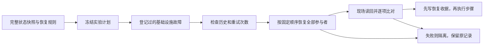

# 分支回溯优化：当前工程接入结果

日期：2026-10-20。来源会话：`01a15819-a82f-7fb0-8088-dcd0e4f6da24`。
来源工具提交：`c51e86d756210e9f76623db25fbf090d282b6234`。

## 本轮完成什么

优化提交的 19 个文件已进入 `/home/pupil/HeteroCoord` 当前工作树。Sol 子代理读取了
指定会话的本地记录，核对提交和全部文件；主代理按补丁整合并完成接口测试，保留
原工程未提交修改。没有整体合并另一条分支，也没有修改论文或提交/推送代码。

| 层次 | 当前职责与变化 | 边界 |
| --- | --- | --- |
| 论文与实验登记 | 决定哪些运行可配对、何种故障允许重试、失败如何计分 | 工具无权把方法失败换成重试成功 |
| 主工程状态管理 | 捕获十类版本化状态；固定顺序恢复；读回不匹配即隔离 | 本轮新增接线只准入同进程诊断 |
| 分支执行工具 | 全局限流、检查恢复登记、保留原始记录、管理资源关闭 | 资源未确认释放时停止新准入，不能把容量表清零假装清理成功 |
| 回放数据读取 | 默认最多缓存 2 段、64 MiB 解压数组；LRU 淘汰；重新校验磁盘 | 控制缓存增长，不承诺 RSS 或吞吐提升 |
| 评价和统计 | 按原登记保留合法失败、未知值和配对范围 | 本次工具接入没有生成正式论文分数 |

状态检查的正确顺序是：

方法超时、错误动作、预算超限等仍是有效方法结果，不进入上述基础设施重试分支。
fresh-process 重建须有新的上游 base-instance 身份；当前活跃任务重建诊断没有改为旧
配对的 `attempt+1`。

## 主工程接线的使用方式

`benchmark/recovery_bridge_v3.py` 提供诊断接线。调用方在静止边界构造
`RegisteredRecoveryV3(registry, ...)`，通过其 `checkpoint` 获取完整快照、通过
`bind(job)` 绑定初始诊断 job，再冻结 explicit jobs 和 run store。适配器返回同一份
冻结 checkpoint。被工具准入的恢复 attempt 在 driver 内先调用
`restore_receipt(runtime_registry, job)`，将返回值写入 checkpoints，再开始 steps。
端到端示例见 `benchmark/tests/test_recovery_bridge_v3.py`。

十类必需状态为物理世界、仿真时钟、控制器、技能、任务、算法、通信、锁、事件、
随机状态。扩展参与者也纳入快照和摘要。恢复顺序固定为上述顺序，其后是按名称
排列的扩展参与者；任何状态漂移、版本不符或恢复失败都会阻止成功收据。

这条桥只接受 `measured_diagnostic`，明确拒绝正式 `measured`。后续阶段已经补上
十类注册状态的持久化存储：保存数据类型、数组形状和内容，用外部固定摘要校验文件，
拒绝覆盖旧产物；恢复桥还检查源码身份、恢复规则和原进程身份。磁盘数据可以在独立
进程中解码，但诊断恢复桥只允许原活跃进程重新加载，不能据此获得进程崩溃后的重试
资格。通用工具检查后端收据一致性，也不能从这些字段证明真实物理恢复。
正式路径仍需要受信原生运行驱动、十类真实状态的恢复提供者和完整物理资格验证。
接口测试使用可控参与者，不能当作已实现 Isaac 隐状态恢复。

最新原生诊断已确认：环境计数器恢复而原生物理时钟没有恢复，后续轨迹对照也失败。
持久化阶段和该失败证据详见 `DURABLE_RECOVERY_PROGRESS.zh-CN.md`。下表保留工具
最初接入阶段的验收结果，不把后续测试重复累加。

## 当前验收

| 检查 | 本轮实际结果 |
| --- | --- |
| 主工程：benchmark、任务、技能、方法桥接、共同协调、拓扑检查 | 586 passed；包含 13 项新增恢复桥测试 |
| 工具：分支执行和物理回放 | 315 passed、14 skipped |
| 新恢复桥 + 通信/状态注册表 | 24 passed，包含在主工程结果中，不额外累计 |
| 独立审查 | 来源文件核对；定位收据来源、持久化和恢复顺序限制；按诊断范围修订 |
| 本地部署检查 | 三个 EAI 组件仍来自当前工程 source；共享环境未修改 |
| 缓存基准 | 64 段、512 帧，状态摘要相同 |

14 项跳过包括：1 项可选场景插件、6 项未启动的 Isaac/GPU 集成、7 项已不随工程
提供的 Fire Rescue 示例入口。本轮没有运行原生 GPU 恢复实验，不宣称全仓测试通过。
ZCode GLM-5.3/max 完成记忆查询、本地导入和 diff 检查；其测试轮在执行 pytest 前
超时，测试验收由主代理完成，没有把未完成的 ZCode 轮次计为独立测试通过。

缓存中保留的解压数组从 25,180,160 字节降到 786,880 字节，减少 96.875%；读取
耗时从约 0.0484 秒升到 0.1448 秒。结果在 `artifacts/tool-cache-integration.json`。
这是明确的内存留存与重复解压开销权衡，不是提速结论。

## 论文版本与后续顺序

原 P0–P5 实施按 `07dcd40` 冻结稿验收，工具提交按 `fc04465` 稿实现。本轮发现论文
工作树已按最新 Overleaf `75ceff6f55202b6b1a31b2e2e0f6de56023940fd` 对齐；该版本包含 D1–D6 新修订以及 paired rerun、external-contention、protective-stop 的协议收紧。
已专门核对本次相关条款：fresh-process 新身份、登记式同检查点同随机流重试、方法
失败不重跑、保留原始记录，均未放宽。旧 controller 子流特殊例外已删除。

新稿指标审查、D1/D4 评价器与持久化层的软件阶段已验收。恢复方向的后续
顺序是：受信运行驱动 → 十类真实参与者覆盖 → 原生恢复/sham 验证 → 正式目录、
独立校准、基线及缺陷对照。既有原地恢复
失败证据仍保留；此前成功的 fresh-process 轨迹是其封存版本的有限诊断证据。

阶段反思：工具优化已接入，接口也已闭环验证；独立审查促使我们把“字段验证、状态
读回、正式物理资格”明确分开，并通过代码拒绝越级使用。旧 native 产物的源码快照
继续有效地描述旧实验，但当前源码已变，不应拿旧轨迹给新版本背书。
