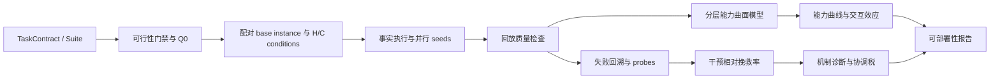

# 异构多机具身协作 Benchmark
# 分层能力曲面与干预相对诊断建模方案

**版本：** 2026-09-15（讨论稿）  
**适用范围：** EAI Simulator `demo/` 下的 Factory、Warehouse、Modern House benchmark 及其后续 Suite   
**提出方法：** HCS-IRD（Hierarchical Capability Surface with Intervention-Relative Diagnosis）

---

## 1. 报告目的与材料范围

本报告基于以下材料形成：

- 场景与服务逻辑：[场景与服务逻辑.pptx](/home/pupil/下载/场景与服务逻辑.pptx)
- Benchmark 设计：[异构多机Benchmark(1).pptx](/home/pupil/下载/异构多机Benchmark(1).pptx)
- 课题组论文：[Cross-robot behavior adaptation through intention alignment](/home/pupil/下载/Chen+等+-+2026+-+Cross-robot+behavior+adaptation+through+intention+alignment.pdf)
- 课题组论文：[TeamWeaver](/home/pupil/下载/2026.teamweaver.pdf)
- 仓库实现：`demo/benchmark/`、`demo/*_benchmark/`、`source/EAI/EAI/scenario_spec/`、`tools/scenario_generation/`

附件中的数学建议被视为研究材料和讨论对象，不是本报告的强制指令。本报告的目标是提出一套更容易实现、审计和发表的统计建模方案。

仓库当前的科学范围文件明确指出：当前系统仍是“validated scenario generation and execution-harness prototype”；运动学搬运不能被解释为物理抓取成功，单一 Factory 场景也不能支持一般化部署声明。[SCIENTIFIC_SCOPE.md](/home/pupil/eai-simulator/tools/scenario_generation/SCIENTIFIC_SCOPE.md)

---

## 2. 核心结论

Benchmark 真正缺少的不是更多指标，而是三个定义：

1. **统计对象：** 哪些回合属于同一个实验单位，哪些变量是配对的；
2. **估计量：** 要估计的是成功率、能力、因子效应、挽救率还是迁移速度；
3. **因果边界：** 回放探针能够支持哪种诊断声明，不能支持哪种真实世界因果声明。

建议采用 HCS-IRD：

1. 用分层 Bayesian GLMM 估计 H/C 条件下的性能曲面；
2. 在 development split 上使用带层级收缩的多维 IRT 作为潜在能力解耦层；
3. 对失败回合使用配对回放和探针，报告“干预相对挽救率”；
4. 将 IAIL 式语义空间作为迁移和表征解释层，而不是主评分器；
5. 用 IQM、分层 bootstrap、配对效应和性能分布替代单一平均成功率。

这一方案保留了 benchmark 的主线：

> 异构净收益 = 互补能力收益 − 协作成本

同时避免把 NC-MIRT、DINA、双曲几何、Wasserstein、PN、Fine-Gray、Shapley 和注意力图谱全部混成一个不可识别的总模型。

---

## 3. 对现有六类数学方案的审查

### 3.1 NC-MIRT：适合辅助分析，不适合作为统一主模型

附件提出的非补偿模型为：

\[
P(Y=1)=c+(1-c)\prod_k \sigma(a_k(\theta_k-b_k))
\]

它表达了“必要能力不可互相代偿”，对联合搬运、互补感知和严格时序任务有直觉意义。但在当前 benchmark 条件下存在四个问题：

- H1/H2/H3 与 C1–C5 的维度较多，而可用团队、任务和条件数量可能不足以稳定识别所有参数；
- 连乘形式会使成功概率快速接近零，降低任务之间的区分能力；
- (c_j) 会把仿真数值漂移、随机物理扰动、感知失败和真正的随机猜测混在一起；
- AGHQ/MMLE 在少量团队、很多项目且能力分布偏斜时可能不稳定。

2026 年的 IRT 审查研究特别指出，AI benchmark 通常具有“少量被评估系统、很多项目、能力分布偏斜或多峰”的数据形态，经典 IRT 估计器可能不可行，快速估计器又可能给出不可靠的项目参数和模型排名。[Can We Trust Item Response Theory for AI Evaluation?](https://arxiv.org/abs/2607.15190)

建议：主分析使用分层 GLMM；IRT 只在 development split 中作为能力解耦层；对明确具有硬门禁的任务再做 NC-MIRT 敏感性分析。不要把 (c_j) 解释成仿真中的“侥幸成功率”。

### 3.2 DINA 与 Q 矩阵：必须防止结果泄漏

TaskContract 已经包含 phase graph、技能、最小团队证书和探针插点，这些内容天然提供 Q 矩阵先验。若使用同一批测试数据通过 BMF 修改 Q 矩阵，再用修改后的 Q 矩阵解释这些数据，会形成循环解释。

建议流程：

1. 上游规则和专家产生 (Q_0)；
2. 只在 development split 用稀疏 Bayesian logistic regression 或 BMF 校准；
3. 冻结 \(\hat Q\)；
4. 在 test split 检验 Q 矩阵的预测和测量不变性。

DINA 适合输出“技能是否掌握”的离散证书，但不适合作为通信带宽、延迟、churn、迁移预算等连续变量的统一模型。

### 3.3 IAIL、双曲空间和 Wasserstein：适合作为表征层

IAIL 的核心贡献是使用自然语言意图把不同机器人形态的轨迹投影到共同空间，再根据意图相似度进行行为匹配。论文在 7 台不同机器人、30 个场景上报告了任务成功率、适应准确率、类内/类间距离和跨 embodiment 对齐误差。[Cross-robot behavior adaptation through intention alignment](https://pubmed.ncbi.nlm.nih.gov/41849566/)

这非常适合 C5 迁移评测，但语义距离本身不能证明通信、角色或时序机制的因果作用。

建议：

- 用轨迹编码器和文本编码器构造语义空间；
- 报告跨机体检索准确率、类内距离、类间分离度、对齐误差和未见机器人迁移；
- 不用 embedding distance 直接代替成功率或协调税；
- 双曲空间仅在任务层次确实很深、且 held-out 任务上优于欧氏空间时纳入正式结果；
- Wasserstein 距离可作为能力供需分布的探索性指标，但必须报告嵌入、权重和度量的敏感性。

### 3.4 PN：探针结果应命名为“干预相对挽救率”

对于同一个回放状态，可以直接观测：

\[
Y_e^{fact},\qquad Y_e^{probe}
\]

对事实失败回合定义：

\[
RR_k=P(Y_e^{probe}=1\mid Y_e^{fact}=0,\; replay\ valid)
\]

这回答的是：

> 在当前回溯状态、噪声带和探针权限下，替换机制 (k) 有多大概率挽救该失败？

它不是自动可识别的总体 PN，也不证明该机制是唯一根因。原因包括：探针在失败后触发、只有到达回溯点的回合才能接受探针、探针可能改变多个下游变量、回放可能存在数值漂移。

正式报告建议使用：

- intervention-relative rescue rate；
- rescue rate 的 cluster bootstrap 置信区间；
- replay mismatch rate；
- probe side-effect rate；
- 单探针与联合探针的差异。

2026 年的 Interventional Causal Circuits 工作同样把机器人失败测试建模为干预分布下的成功概率、故障原因和修复区域，而不是简单统计失败次数。[Interventional Causal Circuits](https://arxiv.org/abs/2607.14826)

### 3.5 Fine-Gray 与 landmark：作为后续分析

当前执行器使用离散模拟步，终止状态包括 deadlock、timeout、cancelled 和 steps exhausted。MVP 更适合离散时间 hazard：

\[
\operatorname{logit}P(E_t=k\mid E_t\geq 0)=
\alpha_{k,t}+\beta_k^T X+u_{family}+u_{layout}
\]

它可以处理离散时间、多个失败原因和提前终止。只有当失败时间、竞争事件和删失机制足够稳定时，才把 Fine-Gray 作为累积发生率的补充模型。Fine-Gray 和原因特异风险对应不同 estimand，不能混用。[Fine–Gray competing-risk discussion](https://www.mdpi.com/2076-3417/13/14/8230)

### 3.6 Shapley：作用于机制集合，不宜直接作用于机器人联盟

删除机器人会同时改变能力、可行性、团队规模、通信拓扑和调度难度，因此机器人联盟的 (v(S)) 往往不是同一问题下的边际贡献。

建议：

- H/C 主效应和交互使用配对 factorial design；
- Shapley 只作用于少量探针或机制集合；
- 机器人联盟 Shapley 作为资源配置附加分析，不作为主能力估计。

---

## 4. HCS-IRD 主模型

### 4.1 实验单位

每个分支定义为：

\[
e=(f,l,b,c,m,g,r,q)
\]

其中：

- (f)：任务骨架或 family；
- (l)：物理布局；
- (b)：base instance；
- (c)：H/C condition；
- (m)：被测方法；
- (g)：机器人团队；
- (r)：随机种子；
- (q)：分支类型，如 factual、probe 或 adaptation。

同一个 base instance 的不同条件应共享初态、目标、布局和噪声带。family、layout 和 base instance 是 bootstrap 和随机效应的关键层级，不能把所有 episode 当作独立样本。

每个分支至少保存：

\[
Y_e,\quad K_e,\quad T_e,\quad E_e,\quad F_e,\quad D_e
\]

分别表示完整成功、完成的 predicate 数、完成/失败时间、能耗或距离、失败类型和回放状态差异。

### 4.2 二值成功模型

\[
Y_e\sim\operatorname{Bernoulli}(p_e)
\]

\[
\operatorname{logit}(p_e)=
\alpha+\delta_m+
\boldsymbol\beta_H^T\mathbf H_e+
\boldsymbol\beta_C^T\mathbf C_e+
\mathbf H_e^T\Gamma\mathbf C_e+
u_f+u_{l(f)}+u_b+u_g
\]

其中：

- (mathbf H)：H1/H2/H3；
- (mathbf C)：C1–C5；
- (Gamma)：预注册交互项，例如 H3×C1、H1/H2×C2、C3×C4；
- (u_f)：任务骨架随机效应；
- (u_l)：布局随机效应；
- (u_b)：base instance 随机效应；
- (u_g)：团队配置随机效应。

模型可使用 Stan、PyMC、brms 或 glmmTMB 实现。Bayesian 版本便于输出后验区间和层级收缩；频率学派版本适合快速批量分析。

### 4.3 部分完成度模型

当前 evaluator 已经提供 predicate-level completion，不应只把它压成一个辅助数字。定义：

\[
K_e\sim\operatorname{BetaBinomial}(J_e,\mu_e,\phi)
\]

其中 (K_e) 是满足的 predicate 数，(J_e) 是总 predicate 数。这样可以保留任务完成比例、失败阶段和早期/晚期失败的信息。BEHAVIOR-1K 也采用部分谓词完成度作为主要成功分数，并把模拟时间、移动距离和末端执行器位移作为效率指标。[BEHAVIOR evaluation protocol](https://github.com/StanfordVL/BEHAVIOR-1K/blob/main/docs/challenge/evaluation.md)

### 4.4 连续性能模型

时间、距离、通信量和重规划次数分别使用 Gamma、log-normal 或负二项分层模型。主报告不强制将它们压缩为一个分数。

如果部署决策需要标量效用，可在 test split 之前冻结：

\[
U_e=w_sY_e+w_q\tilde K_e-w_t\tilde T_e-w_E\tilde E_e-w_I\tilde I_e
\]

同时报告原始指标和 (U_e)，并给出 Pareto frontier。权重不能根据 test 结果倒推。

---

## 5. 潜在能力解耦层

在 development split 上使用带层级收缩的多维 IRT：

\[
\boldsymbol\theta_{g,m}
\sim
\mathcal N(\boldsymbol\mu_{type(g),m},
\operatorname{diag}(\boldsymbol\sigma_m^2))
\]

\[
\operatorname{logit}P(Y_{e,j}=1)=
-b_j+\mathbf q_j^T\boldsymbol\theta_{g,m}+\mathbf x_e^T\boldsymbol\beta
\]

其中：

- (oldsymbol\theta_{g,m})：团队—方法潜在能力；
- (b_j)：任务实例难度；
- (mathbf q_j)：TaskContract 产生的需求向量；
- (mathbf x_e)：H/C 压力条件。

对于严格的联合必要任务，再拟合：

\[
P(Y=1)=\prod_{k\in\mathcal K_j}\sigma(\theta_k-b_{jk})
\]

但把它作为敏感性分析，而不是所有任务的统一假设。

最终不建议用雷达图面积作为主分数，而是估计每个因子的标准化能力曲线：

\[
g_k(x)=E[Y\mid do(X_k=x),\text{其它条件标准化}]
\]

从后验曲线提取：

- 因子 AUC：压力区间内的平均能力；
- 临界点：性能下降最快的位置；
- 稳健裕量：性能下置信界仍高于部署阈值的范围；
- 交互曲面：例如 (g_{H3,C1}(x,y))。

这直接回答“带宽降到什么程度会失去可部署性”，比静态雷达图更适合工程决策。

---

## 6. 把上游任务生成变成统计实验设计

上游不应只追求生成更多任务，而应根据当前后验不确定性选择信息量高的任务。可以定义候选任务 (a) 的期望信息增益：

\[
a^*=\arg\max_a
\frac{E_{y\sim p(y\mid a,D)}
\left[KL(p(\beta\mid D,y,a)\|p(\beta\mid D))\right]}
{\operatorname{cost}(a)}
\]

实际选择还需满足：

- 覆盖 H1/H2/H3 和 C1–C5；
- 每个主因子至少有低、中、高压力等级；
- 保留预注册交互项；
- 不访问 test split；
- 不只选择最容易区分当前方法的任务；
- 保留随机任务作为外部校验。

这与 IRT 的 optimal test design、tinyBenchmarks 和 Anchor Points 的思想相近，但目标从“估计模型排名”扩展为“最大化 H/C 因子效应的信息量”。[tinyBenchmarks](https://arxiv.org/abs/2402.14992)；[Anchor Points](https://arxiv.org/abs/2309.08638)

---

## 7. Replay-and-Intervene 诊断

对每个 factual 失败回合，在同一个回溯点 (t_k) 创建：

- factual continuation；
- I-skill；
- I-comm；
- I-role；
- I-timing；
- 必要时的联合 probe。

定义：

\[
R_{e,k}=Y_{e,k}^{probe}-Y_e^{fact}
\]

只在 factual 失败且 replay fidelity 通过时计算：

\[
RR_k=\frac{1}{n_k}\sum_{e:Y_e^{fact}=0}Y_{e,k}^{probe}
\]

加入探针成本和副作用后，可使用：

\[
NR_k=RR_k-\lambda Cost_k-\rho Harm_k
\]

对四个探针做小型 factorial 分析：

\[
\operatorname{logit}P(Y^{probe}=1)=
\alpha+\sum_k\eta_kI_k+\sum_{k<l}\eta_{kl}I_kI_l
\]

解释规则如下：

| 回放结果 | 允许的声明 |
|---|---|
| 一个 probe 单独挽救 | 该干预在当前集合下具有充分挽救作用 |
| 多个 probe 均可挽救 | 存在多条替代修复路径 |
| 只有联合 probe 可挽救 | 存在交互或级联失效 |
| 所有 probe 均不能挽救 | 当前 probe 集合无法解释，或回放/可行性存在问题 |

已知故障注入任务应提供 ground-truth cause，用来计算 probe 的 precision、recall、混淆矩阵和 calibration，而不是只看 rescue rate。

---

## 8. 协调税与异构净收益

建议首先定义：

\[
Gap_{coord}=U_{oracle}-U_{actual}
\]

机制税定义为标准化干预对比：

\[
Tax_k=E[U^{do(C_k=ideal)}-U^{actual}]
\]

当机制之间存在交互时：

\[
Gap_{coord}=\sum_kTax_k+\sum_{k<l}Tax_{kl}+\epsilon
\]

异构收益定义为：

\[
HG=U_{heterogeneous}-U_{best\ homogeneous}
\]

最终：

\[
NHG=HG-Gap_{coord}
\]

该定义保留“互补收益减协作成本”的主线，同时避免把联盟可行性、机器人数量变化和单机边际贡献混成同一个 Shapley 值。

Shapley/SII 可以作为机制集合或小规模探针集合的附加分析。若用于机器人联盟，必须明确说明联盟变化同时改变了任务可行性和问题定义。

---

## 9. C5 迁移和有限步适应

C5 应与普通成功率分开报告，至少区分：

- zero-shot coordination；
- finite-budget adaptation；
- unseen embodiment；
- unseen partner policy。

有限步适应可以使用：

\[
p(b)=\operatorname{logit}^{-1}[\alpha+A(1-e^{-\lambda b})]
\]

其中 (b) 是观察或交互次数，(alpha) 是零样本性能，(A) 是可达到的增益，(lambda) 是适应速度。

报告：zero-shot score、adaptation AUC、达到部署阈值所需的交互预算、未见机器人差值和未见伙伴差值。Adaptive Coordination 在 Social Rearrangement 中也将 zero-shot coordination、伙伴变化和效率作为独立问题分析。[Adaptive Coordination in Social Embodied Rearrangement](https://arxiv.org/abs/2306.00087)

---

## 10. 语义空间和图结构的使用边界

可以采用 IAIL 式编码：

\[
z_{traj}=f_{\psi_m}(\tau_m),\qquad z_{text}=f_\xi(l)
\]

用训练任务上的 InfoNCE 对齐轨迹和语言意图，测试时报告：

- cross-embodiment retrieval accuracy；
- same-intention intra-class distance；
- inter-class separation；
- alignment error；
- unseen robot transfer；
- 语义空间对失败类别的预测能力。

Transformer attention 权重不能直接解释为真实因果信息流。正式模型应优先使用实际通信事件、延迟、丢包、消息消费、拓扑连通度和资源占用。若使用图拉普拉斯，可把代数连通度和网络熵作为过程指标，而非直接的能力分数。

---

## 11. 统计汇总与不确定性

推荐的 benchmark 汇总顺序：

1. 以 family/layout/base instance 为 cluster；
2. 对条件差异使用 matched paired bootstrap；
3. 对成功率报告 Wilson 或 Bayesian credible interval；
4. 对跨任务汇总报告 IQM、performance profile 和 probability of improvement；
5. 对预注册 H×C 交互报告后验区间或模型系数；
6. 对多重确认性检验使用 hierarchical shrinkage，并对剩余频率学派检验做 BH-FDR。

RLiable 研究指出，均值容易被异常任务主导，中位数又可能忽略大量零分任务；IQM、分层 bootstrap 和性能分布更适合有限运行次数的 RL/机器人 benchmark。[Deep Reinforcement Learning at the Edge of the Statistical Precipice](https://arxiv.org/abs/2108.13264)

单一数字不应被表述为“系统的一般能力”。结果需要同时附带任务数量、family 数量、seed 数量、物理版本、资产 hash、控制器版本、超时、排除回合和证据 tier。

---

## 12. 推荐的数据流

建议增加四类机器可读产物：

1. `episode_observation.jsonl`：每个 branch 的观测和 provenance；
2. `capability_surface.json`：H/C 因子的后验曲线、临界点和稳健裕量；
3. `probe_diagnosis.json`：回溯、探针、救援和 replay fidelity；
4. `benchmark_report.json`：聚合指标、区间、版本、排除原因和证据 tier。

---

## 13. MVP 实施路线

### M0：协议冻结

- 冻结 TaskContract 字段和 H/C 因子定义；
- 冻结 family/layout/base instance 的统计层级；
- 定义 replay fidelity 阈值；
- 预注册主效应、交互项、主要结果和排除规则。

### M1：三个最小任务

使用 TRN-01、SAR-01、COV-03，分别覆盖技能/时序、信息×通信、结构×churn。

只实现：

- factual/probe 配对数据；
- 分层 Bayesian GLMM；
- matched rescue rate；
- IQM 和 cluster bootstrap CI。

### M2：诊断校准

- predicate-level beta-binomial；
- H/C 交互项；
- known fault injection；
- probe precision、recall、混淆矩阵；
- zero-shot/finite-budget adaptation 曲线。

### M3：能力与扩展

- 分层 IRT；
- IAIL 式语义空间；
- Bayesian information-gain 任务选择；
- 机制集合 Shapley；
- 双曲空间、Wasserstein 和 Fine-Gray 的敏感性分析。

MVP 的成功标准不是“任务能跑”，而是：

1. H/C 因子能够被隔离；
2. oracle 在重复运行中稳定；
3. replay mismatch 可量化；
4. 已知故障能够被正确诊断；
5. 主要效应和 probe rescue 在独立 family/layout 上复现。

---

## 14. 与现有 benchmark 和论文的对应关系

| 来源 | 可借鉴内容 | 在本方案中的位置 |
|---|---|---|
| PARTNR | LLM 生成、仿真过滤、长程多智能体任务 | 上游任务生成和结构验证参考；[PARTNR](https://arxiv.org/abs/2411.00081) |
| BEHAVIOR-1K | predicate partial success、效率指标、held-out instances | 结果定义和部分完成度参考 |
| HeMAC | 明确的异构角色、不同观测和动作空间 | H/C 任务族设计参考；[HeMAC](https://arxiv.org/abs/2509.19512) |
| Adaptive Coordination | zero-shot partner、伙伴变化、效率 | C5 迁移协议参考 |
| IAIL | 轨迹—语言意图对齐、跨 embodiment 迁移 | 语义表征和迁移诊断参考 |
| TeamWeaver | LLM 语义解析与 MIQP 约束分离 | 上游需求解析、可行分配和 oracle 参考 |
| RLiable | IQM、分层 bootstrap、performance profile | 主统计汇总方法 |
| tinyBenchmarks / Anchor Points | item selection、少量高信息任务 | 上游 Suite 的信息增益选择 |
| Interventional Causal Circuits | 干预、失败原因和修复区域 | Replay-and-Intervene 的外部方法参照 |
| OopsieVerse / FailureBench | 安全、损伤和失败模式显式化 | 后续安全与故障扩展参考 |

PARTNR 已展示大规模任务生成和仿真验证的价值，但其规模不能掩盖当前 EAI 原型在物理操作、场景泛化和证据 tier 上的边界。[PARTNR](https://arxiv.org/abs/2411.00081)

---

## 15. 最终建议

建议论文和 benchmark 首版将主张收敛为：

> 我们提出一个面向异构具身团队的分层能力曲面与干预相对诊断框架。该框架在受控 H/C 条件、配对物理回放和最小权限探针下，估计异构团队的任务条件能力、协作机制效应、失败挽救率和伙伴迁移曲线。

正式结果优先报告能力曲线、交互效应、协调鸿沟和 probe rescue 的可信区间；语义空间、双曲几何、Wasserstein、Shapley 和 Fine-Gray 作为有明确验证目标的扩展分析。

这样既保留了“异构净收益 = 互补收益 − 协调成本”的研究主线，又使每个统计量都能够对应一个明确的实验操纵、一个明确的比较对象和一个明确的因果边界。

